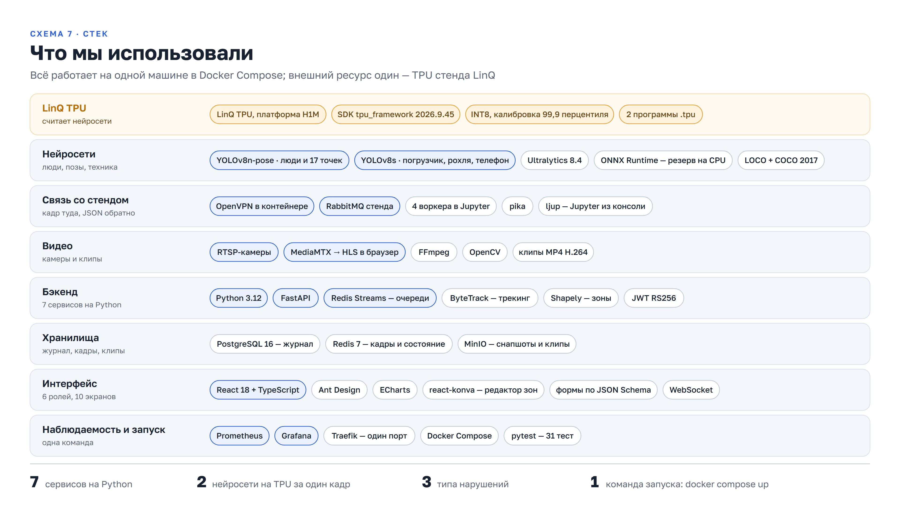

# LinQ Safety

**Краткое описание решения**

Видеоконтроль нарушений техники безопасности на российском ускорителе LinQ TPU

| 1,05 с | 2,7 с | 6,6 кадр/с | 1 → 1 |
|---|---|---|---|
| от кадра с нарушением до оповещения в браузере (медиана) | от начала нарушения до оповещения, вместе с окном подтверждения | через LinQ TPU, две нейросети на каждом кадре | одно нарушение — одно оповещение |

## 1. Что делает решение

Сервис смотрит на все камеры цеха сразу, находит нарушения техники безопасности нейросетями на **LinQ TPU** и за
секунды оповещает диспетчера и мастера участка: что нарушено, где, когда, плюс кадр с рамкой и клип.

- **Распознаёт три нарушения:** человек в опасной зоне, опасное сближение с погрузчиком или рохлей, телефон в руке.
- **Не поднимает ложных тревог от одного кадра:** нарушение должно длиться 1–3 секунды подряд, повтор не дублирует оповещение.
- **Оповещает адресно:** в браузере со звуком и в Telegram, по роли и участку; непринятое событие эскалируется руководству.
- **Хранит доказательства:** исходный кадр с хэшем SHA-256, кадр с рамкой, клип ±5 с, история действий людей.
- **Настраивается без программиста:** зоны рисуются на кадре камеры, правила включаются с параметрами и расписанием.
- **Показывает статистику:** журнал с фильтрами и экспортом, дашборд «где и когда нарушают», замеры скорости TPU.

## 2. Как это работает

1. Камера отдаёт RTSP-поток (или видеофайл, или папку кадров). Сервис захвата берёт 5 кадров в секунду и сжимает их в JPEG.
2. Кадр уходит на **LinQ TPU**: две нейросети находят людей со скелетом из 17 точек, погрузчики, рохли и телефоны.
3. Трекер ведёт каждого человека от кадра к кадру под одним номером.
4. Сценарии-плагины оценивают каждого человека по правилам камеры: в зоне ли он, далеко ли от техники, нет ли телефона у руки.
5. Конечный автомат решает, что нарушение настоящее: оно длится заданное время, а не мелькнуло на одном кадре.
6. Событие записывается в журнал, сохраняются кадр и клип, оповещение уходит тем, кому оно положено.


## 3. Путь кадра внутри системы


Семь сервисов на Python в одном Docker Compose. **Горячий путь** — захват → распознавание → анализ → журнал →
оповещения — идёт через очереди Redis Streams: сообщение снимается только после обработки, поэтому рестарт любого
сервиса не теряет событий. Вход, роли и настройка камер в горячем пути не участвуют: если они упадут,
детекция продолжит работать на конфигурации, сохранённой в Redis.

## 4. Распознавание на LinQ TPU


- TPU стоит на стенде LinQ и общий для всех команд. Наш сервер связан с ним через VPN, поднятый внутри Docker-контейнера,
  и очередь RabbitMQ стенда.
- Четыре воркера в Jupyter стенда готовят тензоры и отправляют на TPU **обе нейросети одновременно**; тело сети TPU
  считает в INT8, небольшой хвост (декодирование рамок, NMS) — CPU воркера.
- В модель всегда идёт свежий кадр: устаревшие и лишние кадры пропускаются, очередь не копится.
- Если стенд не отвечает, кадры автоматически идут на CPU нашего сервера в тех же моделях, через 30 с — снова на TPU.
- Квантование подбирали на эмуляторе SDK: калибровка по 99,9-му перцентилю подняла совпадение модели техники на TPU
  с исходной с 0,65 до 0,98 — без этого TPU не видел погрузчик.

## 5. Одно нарушение — одно оповещение


| Нарушение | Нейросети | Важность | Окно | Правило |
|---|---|---|---|---|
| Человек в опасной зоне | поза | высокая | 2 с | точка опоры человека внутри полигона зоны |
| Опасное сближение с техникой | поза + объекты | критичная | 1 с | ближе одного роста человека до погрузчика или рохли; водитель в технике не считается |
| Телефон в руке | поза + объекты | средняя | 3 с | телефон у кисти или у головы |

Новый тип нарушения — один файл с классом сценария: он сразу появляется в интерфейсе с формой параметров.
Подтверждение, окончание, паузу перед повтором и склейку трека, если человек на секунду скрылся за погрузчиком,
делает общий каркас.

## 6. Что использовали



| Модель | Что находит | Как получена | Качество |
|---|---|---|---|
| YOLOv8n-pose | люди и 17 точек скелета | готовые веса COCO, калибровка и компиляция под TPU | TPU и CPU: те же рамки, уверенность ±0,05 |
| YOLOv8s-objects | погрузчик, рохля, телефон | дообучение на LOCO (склады) и COCO, проверка на другом складе | mAP50: телефон 0,53, погрузчик 0,36, рохля 0,28 |

## 7. Интерфейс

<p class="pair"> </p>

Слева — лента событий диспетчера: нарушения приходят в реальном времени, «Подтвердить», «Ложное», «Передать мастеру» —
прямо на карточке. Справа — настройка камеры: зона рисуется на кадре, правила включаются без кода. Всего 10 экранов
для шести ролей: камеры, лента, карточка события с клипом, журнал, дашборд, производительность TPU и другие.

## 8. Результаты

Замер 24.10.2026 на работающей системе: 7 камер по 5 кадров/с, обе нейросети на LinQ TPU.

| Что | Результат |
|---|---|
| Кадр через TPU, средняя задержка | 950 мс: TPU с очередью общего стенда 721, сеть 161, обработка на CPU 68 |
| Пропускная способность | 6,6 кадров/с на все камеры; лишние кадры пропускаются, задержка не копится |
| От кадра с нарушением до браузера | медиана 1,05 с, 95 % — до 1,9 с |
| От начала нарушения до оповещения | медиана 2,7 с (из них 1–2 с — окно подтверждения) |
| Сервер для 7 камер | около 0,7 ядра CPU и 3 ГБ памяти, GPU не нужен; трекинг и сценарии — меньше 5 мс на кадр |
| Проверки | 31 автотест и сквозная проверка от входа до клипа проходят |

## 9. Запуск и что дальше

```bash
docker compose up -d --build              # вся система; интерфейс — http://localhost:8080, вход кнопкой любой роли
python backend/server/tools/smoke.py      # сквозная проверка
# режим TPU: в .env INFERENCE_BACKEND=broker, затем docker compose --profile linq up -d linq-vpn
```

- **Честно о границах:** реализовано три сценария из задуманных восьми; общий TPU стенда при семи камерах даёт около
  1 кадра/с на камеру; событийные precision и recall на размеченных роликах с производства ещё не измерены — система
  собирает их онлайн из отметок операторов.
- **Следующие шаги:** модель позы крупнее, сценарии падения и бега на той же позе, оценка на своих роликах,
  выделенное устройство TPU вместо общего стенда.

Подробности — в технической документации: [DOCUMENTATION.md](DOCUMENTATION.md) и [Техническая_документация.pdf](Техническая_документация.pdf).
