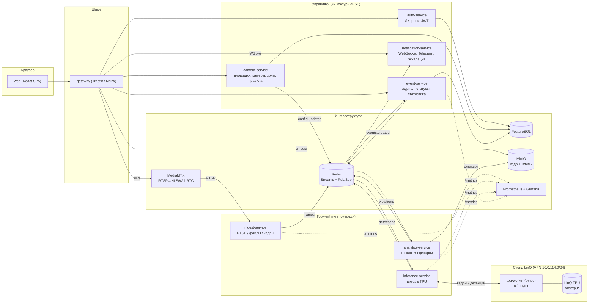
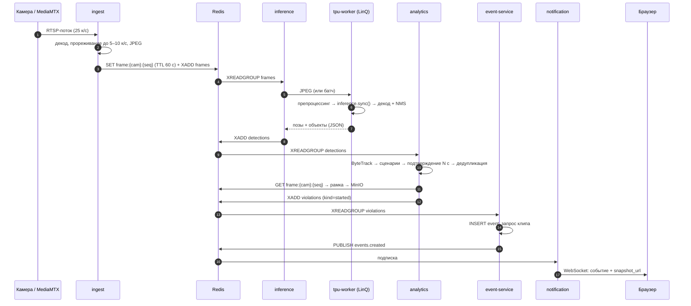
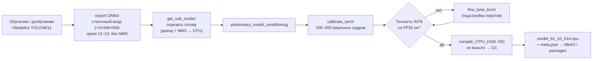

# Архитектура: видеоконтроль нарушений ТБ на LinQ TPU

> Кейс LinQ, хакатон «Открой Моспром». Документ описывает целевую микросервисную архитектуру, стек, источники данных и план работ до защиты 25.10.

## 0. Коротко

- **Девять собственных сервисов**: веб-интерфейс, личный кабинет и авторизация, конфигурация камер, захват видео, инференс (шлюз к TPU), аналитика нарушений, журнал событий, уведомления. Плюс инфраструктура: шлюз, PostgreSQL, Redis, MinIO, MediaMTX, Prometheus/Grafana.
- **Горячий путь** «кадр → тревога» идёт через очереди Redis Streams: `ingest → inference → analytics → events → notifications → браузер`. Сервисы ЛК, настройки и статистики в нём не участвуют: если они упадут, детекция продолжит работать.
- **Инференс изолирован** за интерфейсом `Backend`. Реализации: `pytpu` (LinQ TPU, основная) и `onnxruntime` (CPU, для разработки и как запасной вариант). Код сервиса не меняется при смене железа.
- **Каждое нарушение — плагин** аналитики. Новый тип нарушения = новый файл, параметры настраиваются из UI по JSON Schema. Это прямое требование кейса о расширяемости.
- **Главный технический риск** — связность между Jupyter на стенде LinQ (там физически стоит TPU) и нашим бэкендом. Проверяем первым делом (раздел 6.4).

---

## 1. Исходные условия и ограничения

### 1.1 Что требует кейс

| Требование | Где закрываем |
|---|---|
| Приём видеопотоков или наборов картинок | `ingest-service` (RTSP / файл / папка кадров) |
| Распознавание нарушений нейросетями | `inference-service` + `analytics-service` |
| Оповещение: кадр/фрагмент, камера, время, тип | `event-service` + `notification-service` + UI |
| Одно нарушение = одно оповещение | конечный автомат с подтверждением и дедупликацией в `analytics-service` |
| Журнал с фильтрами по типу, камере, зоне, времени | `event-service` |
| Инференс на LinQ с замерами скорости | `inference-service` (бэкенд `pytpu`) + Prometheus + бенчмарк |
| *Желательно:* зоны и правила под камеру, дашборд, подтверждение оператором, несколько потоков | `camera-service`, `event-service /stats`, статусы событий, шардирование кадров |
| Задержка «событие → оповещение» — единицы секунд | бюджет задержки, раздел 4.3 |
| Новые паттерны без переделки системы | реестр сценариев-плагинов, раздел 7.3 |

### 1.2 Что выяснилось из SDK LinQ (`tpu_framework_2026.9.45` и пример API)

| Факт | Следствие для архитектуры |
|---|---|
| SDK работает только на Linux (Ubuntu 18.04+), **Python 3.12.11**, колёса `linux_x86_64` | Компилируем модели в Docker (`python:3.12`) или WSL2, не на «голом» Windows |
| Маршрут: ONNX → `preliminary_model_conditioning` → калибровка `RegularModel.calibrate_torch` → `quantize` (**INT8**) → `compiler.compile_(TPU_H1M, …, O1/O5)` → файл `.tpu` | Отдельный ML-пайплайн `ml/export` → `ml/compile`; артефакт — `.tpu` с версией |
| **Динамические формы не поддерживаются**, batch фиксируется при компиляции (`*_b1_*.tpu`) | Фиксированный вход (например, 1×3×640×640), letterbox в препроцессинге; при необходимости — отдельные программы b1 и b4 |
| В списке поддерживаемых моделей есть `yolov8n_pose`, `yolov8m_seg`, `yolo11n_obb`, `yolo12m`, `yolo5s`, `ssd_mobilenet`, `scrfd`. Голова YOLO **отрезается** (`get_sub_model`), декодирование и NMS — на CPU | Берём семейство YOLOv8/11. Постпроцессинг (DFL-декод + NMS) пишем сами на numpy и сверяем с onnxruntime |
| Рантайм: `pytpu.Device.list_devices()` → `/dev/tpu*`, `device.load(prog.tpu)`, `program.inference()`, `inference.sync({input: np.float32}) → {output: np.float32}` | Код инференса должен **физически выполняться на хосте с TPU**, то есть в Jupyter стенда `hackathon.lin-q.ru`. Рантайм сам квантует float32 ↔ int8 |
| Память TPU (по метаданным программы): 2 банка DDR по 256 МБ, платформа H1M | Лёгкие модели (n/s) помещаются. Проверить, можно ли держать две программы одновременно |
| В примере калибровка идёт на `np.random` — авторы прямо пишут, что нужны реальные данные | Собираем калибровочный набор из 200–500 реальных кадров нашей предметной области |
| Пресет O5 может не скомпилироваться — тогда O1 | В скрипте компиляции делаем автоматический откат на O1 |

### 1.3 Доступ к стенду

- VPN по [artifacts/Hakathon.ovpn](../artifacts/Hakathon.ovpn) (маршрут только 10.0.114.0/24, логин и пароль у капитана).
- Jupyter: `http://hackathon.lin-q.ru/`. Папка `examples` — пример ResNet50 на TPU, папка `packages` — наши пакеты.
- Программы `.tpu` компилируются **локально** и загружаются на стенд.

---

## 2. Принципы

1. **Горячий путь отделён от управляющего.** Кадры, детекции и нарушения идут через очереди. ЛК, настройки и статистика — обычные REST-сервисы с БД.
2. **Сервис владеет своими данными.** Отдельная схема PostgreSQL на сервис (`auth`, `config`, `events`). В чужую схему никто не ходит: только API или события.
3. **Асинхронная связь через события, синхронная — только для чтения конфигурации.** Изменения конфигурации рассылаются событием `config.updated`, потребители держат кэш.
4. **Железо за абстракцией.** `Backend` в инференсе, `Scenario` в аналитике, `Source` в захвате.
5. **Наблюдаемость с первого дня.** Каждый сервис отдаёт `/metrics` и `/health`. FPS и задержки на LinQ — это обязательная часть сдачи, а не украшение.
6. **Всё запускается одним `docker compose up`**, кроме TPU-воркера, который живёт на стенде.

---

## 3. Общая схема



---

## 4. Потоки данных

### 4.1 Горячий путь: от кадра до тревоги



### 4.2 Управляющий путь

1. Специалист по охране труда рисует в UI полигон опасной зоны на снапшоте камеры и включает сценарии с параметрами.
2. `camera-service` сохраняет данные и публикует `config.updated {camera_id, version}`.
3. `analytics-service` и `ingest-service` перечитывают конфигурацию камеры. Без перезапуска, применяется к следующему кадру.

### 4.3 Бюджет задержки (цель — ≤ 3 с до появления в UI)

| Этап | Оценка | Чем измеряем |
|---|---|---|
| Захват и декод | ≤ 100 мс | `ingest_decode_seconds` |
| Очередь до инференса | ≤ 50 мс | `stream_lag_seconds{stream="frames"}` |
| Сеть до TPU через VPN (туда и обратно) | 20–80 мс | `tpu_rpc_seconds` |
| Пре- и постпроцессинг + TPU | **измерить** (ожидаем десятки мс) | `inference_seconds{stage=pre|tpu|post}` |
| Трекинг и правила | ≤ 10 мс | `analytics_step_seconds` |
| **Окно подтверждения** | 1–3 с (параметр сценария) | задаётся настройкой |
| Запись в БД и push | ≤ 100 мс | `event_e2e_seconds` |

Итоговая задержка ≈ окно подтверждения + ~0,5 с. Окно подтверждения задано **осознанно**: кейс требует, чтобы «нарушение подтверждалось, только если длится несколько секунд подряд».

---

## 5. Сервисы

Все бэкенд-сервисы написаны на **Python 3.12 + FastAPI**. Причины: один язык с ML, SDK LinQ сам на Python 3.12, общая библиотека `libs/common` (схемы сообщений на Pydantic, JWT, Redis-клиент, логирование, метрики).

### 5.1 `web` — фронтенд

| | |
|---|---|
| Стек | React 18 + TypeScript + Vite, Ant Design 5 (`ru_RU`), TanStack Query, Zustand, react-konva (редактор полигонов), ECharts, hls.js, `@rjsf/antd` (формы по JSON Schema) |
| Страницы | Вход · **Лента событий** (оператор) · Карточка события (кадр с рамкой, клип, статусы) · Камеры (живое видео) · **Настройка камеры** (полигоны, сценарии, расписание) · **Журнал** (фильтры, экспорт) · **Дашборд** · **Производительность** (FPS и задержки по моделям) · **Личный кабинет** · Пользователи (админ) |
| Realtime | WebSocket `/ws`: события `event.created`, `event.updated`, приоритетные тревоги со звуком |

### 5.2 `gateway`

Traefik v3 (маршруты через docker labels) или Nginx.
- `/api/auth/*` → auth, `/api/config/*` → camera, `/api/events/*` → events
- `/ws` → notification, `/live/*` → MediaMTX (HLS/WebRTC), `/media/*` → MinIO (presigned)

JWT проверяется в каждом сервисе общей библиотекой: публичный ключ берётся из `auth-service /.well-known/jwks.json`.

### 5.3 `auth-service` — личный кабинет

| | |
|---|---|
| Ответственность | Пользователи, роли (RBAC), вход, JWT (access 15 мин + refresh), профиль, привязка к участкам, настройки уведомлений (какие типы и участки, Telegram) |
| БД | схема `auth`: `users`, `user_areas`, `refresh_tokens`, `notification_prefs` |
| API | `POST /login`, `POST /refresh`, `GET/PATCH /me`, `GET/POST/PATCH /users` (админ), `GET /.well-known/jwks.json` |

**Роли** (из сценариев кейса):

| Роль | Права |
|---|---|
| `admin` | Всё |
| `hse` (охрана труда) | Камеры, зоны, правила, журнал, статистика |
| `master` (мастер, начальник смены) | Тревоги по своим участкам, смена статуса |
| `operator` (диспетчер) | Лента всех событий, статусы, «передать мастеру» |
| `manager` | Дашборд, только чтение |
| `auditor` (юристы) | Журнал и экспорт, только чтение |

### 5.4 `camera-service` — конфигурация

| | |
|---|---|
| Ответственность | Площадки → участки → камеры. Источник (RTSP / файл / папка кадров), целевой FPS. Зоны-полигоны (координаты нормированы 0..1). Правила «сценарий × камера/зона» с параметрами, порогом важности и расписанием (`с 07:55 до 12:00`). Снапшот камеры для редактора |
| БД | схема `config`: `sites`, `areas`, `cameras`, `zones`, `rules` |
| События | `config.updated {camera_id, version}` (Redis Pub/Sub) |
| API | CRUD `/sites`, `/areas`, `/cameras`, `/cameras/{id}/zones`, `/cameras/{id}/rules`, `GET /cameras/{id}/snapshot`, `GET /scenarios` (каталог сценариев с JSON Schema параметров) |

### 5.5 `ingest-service` — захват видео

| | |
|---|---|
| Ответственность | Воркер на каждую камеру: чтение источника (PyAV/FFmpeg), переподключение, прореживание до FPS анализа (5–10 к/с), кодирование JPEG. Кольцевой буфер последних 15 с для клипов |
| Выход | `SET frame:{cam}:{seq}` (TTL 60 с) + `XADD frames:{shard}` с метаданными. Шард выбирается по хэшу камеры |
| Клипы | По `clip.requested {event_id, cam, t0, t1}` собирает MP4 из буфера → MinIO → `clip.ready` |
| Источники | `rtsp://`, локальный файл (зацикленный), папка изображений («стоп-кадры» из кейса) |
| API | `GET /streams` (статус, фактический FPS), `POST /streams/{cam}/restart` |

Для демо камеры имитируем так: `ffmpeg -re -stream_loop -1 -i video.mp4 -c copy -f rtsp rtsp://mediamtx:8554/cam01`. Это настоящий RTSP-путь, как на заводе.

### 5.6 `inference-service` — шлюз к TPU

| | |
|---|---|
| Ответственность | Читает `frames:{shard}`, отправляет кадры в бэкенд, публикует `detections`. Собирает батчи (если скомпилирован b>1), считает метрики, сверяет версии моделей |
| Бэкенды | `PyTpuBackend` — LinQ, выполняется на хосте с `/dev/tpu*`. `OnnxRuntimeBackend` — CPU, для разработки и аварийного режима. `RemoteBackend` — клиент к `tpu-worker` на стенде |
| Модели | `pose` — YOLOv8n/s-pose (люди + 17 ключевых точек). `objects` — YOLOv8s, дообученный на наших классах (раздел 7.1) |
| API | `GET /models` (версии, вход, пресет компиляции), `POST /benchmark` (N кадров → FPS, p50/p95), `/metrics` |

```python
class Backend(Protocol):
    name: str                                   # "pytpu" | "onnx" | "remote"
    def load(self, model: ModelSpec) -> None: ...
    def infer(self, model: str, inputs: dict[str, np.ndarray]) -> dict[str, np.ndarray]: ...
```

Препроцессинг (letterbox 640, нормализация) и постпроцессинг (DFL-декод, NMS, обратное масштабирование) — общий модуль `ml_runtime`. Он одинаковый для всех бэкендов, поэтому результаты CPU и TPU можно сравнить один в один.

### 5.7 `analytics-service` — детектор нарушений

| | |
|---|---|
| Ответственность | Трекинг (ByteTrack из `supervision`) по каждой камере. Геометрия зон (`shapely`). Прогон включённых сценариев. **Временное подтверждение** и **подавление повторов**. Подготовка доказательства: кадр с рамкой → MinIO |
| Вход | `detections`, конфигурация камер (кэш + `config.updated`) |
| Выход | `violations` (`kind=started` / `ended`) |
| Подробности | раздел 7.3 |

### 5.8 `event-service` — журнал и статистика

| | |
|---|---|
| Ответственность | Хранение событий, статусы (`new → confirmed / false / forwarded → resolved`), история действий (кто, что, когда). Фильтры. Агрегаты для дашборда. Экспорт CSV/PDF |
| БД | схема `events`: `events`, `event_actions` (только добавление), `events_hourly` (материализованное представление или TimescaleDB continuous aggregate) |
| Доказательная база | SHA-256 снапшота сохраняется в событии, журнал действий только дополняется. Пригодно для проверок и расследований |
| API | `GET /events?camera=&area=&zone=&type=&status=&from=&to=`, `GET /events/{id}`, `PATCH /events/{id}/status`, `GET /stats/by-type`, `/stats/by-camera`, `/stats/heatmap` (час × день недели), `/stats/precision` (доля подтверждённых), `GET /events/export.csv` |
| События | `events.created`, `events.updated` (Pub/Sub) |

### 5.9 `notification-service`

| | |
|---|---|
| Ответственность | WebSocket-рассылка с учётом роли и участков пользователя, приоритет для критичных событий, **эскалация** (не принято за N минут → начальнику), Telegram-бот (aiogram 3, опционально) |
| Масштабирование | Redis Pub/Sub для рассылки, если экземпляров несколько |

### 5.10 Инфраструктура

| Компонент | Зачем |
|---|---|
| PostgreSQL 16 | Схемы `auth`, `config`, `events` (TimescaleDB — по желанию) |
| Redis 7 | Streams (горячий путь, consumer groups, ack, `MAXLEN`), Pub/Sub (конфигурация, события), временное хранение кадров |
| MinIO | S3 для снапшотов, клипов и моделей `.tpu` / `.onnx` |
| MediaMTX | RTSP-сервер для имитации камер + HLS/WebRTC для браузера |
| Prometheus + Grafana | FPS, задержки p50/p95, отставание очередей, нагрузка TPU, число событий |

> **Если не успеваем.** Можно объединить `auth` + `camera` в `core-api`, а `events` + `notifications` — в один сервис. Горячий путь (`ingest`, `inference`, `analytics`) **не объединяем**: он обязан масштабироваться независимо.

---

## 6. Инференс на LinQ TPU

### 6.1 Подготовка модели (наш ML-пайплайн)



- Всё запускается в контейнере `ml/compile/Dockerfile` (`python:3.12.11-slim` + колёса из `tpu_framework/packets`).
- На выходе `.tpu` плюс `meta.json`: имена входов и выходов, формы, пресет, mAP FP32 и INT8, хэш.
- **Контроль качества квантования**: mAP на валидационном наборе в ONNX FP32, затем в INT8 (эмуляция `as_torch_graph`) и затем на реальном TPU. Допустимая просадка — до 2–3 п.п. mAP.

### 6.2 Рантайм на стенде

```python
import pytpu as tpu

dev = tpu.Device.open(tpu.Device.list_devices()[0])
prog = dev.load("yolov8n_pose_b1_o5_h1m.tpu")
with prog.inference() as inf:
    out = inf.sync({"images": preprocess(frame)})   # float32 на вход и на выход
    persons = postprocess_pose(out)                  # DFL-декод + NMS на CPU
```

### 6.3 Режимы развёртывания инференса

| Режим | Где работает TPU-код | Связь с нашим бэкендом | Когда использовать |
|---|---|---|---|
| **A1. Удалённый воркер, мы — клиент** | `tpu-worker` (FastAPI или WebSocket) запущен в терминале Jupyter | Наш `inference-service` (`RemoteBackend`) ходит на `10.0.114.x:PORT` или через `jupyter-server-proxy` | Порт на стенде доступен из VPN |
| **A2. Удалённый воркер, он — клиент** | То же | `tpu-worker` сам подключается к нашему Redis (`XREADGROUP frames` / `XADD detections`) | Стенд видит наш IP в VPN (или VPS в той же VPN) |
| **B. Весь горячий путь на стенде** | `ingest` + `inference` + `analytics` в Jupyter, источник — видеофайлы | Наружу уходят только `violations` (или файл / HTTP-POST) | Сеть к стенду медленная или закрыта |
| **C. Аварийный** | Живое демо — `OnnxRuntimeBackend` на CPU с **теми же** моделями | — | Стенд недоступен. На TPU отдельно прогоняем бенчмарк и сверку выходов, результаты показываем на странице «Производительность» |

Код для всех режимов один и тот же, меняется только `INFERENCE_BACKEND=pytpu|remote|onnx` и адрес очередей.

**Развёртывание для показа экспертам.** Ubuntu VPS (Yandex Cloud / Selectel / Timeweb) + `docker compose`. VPS подключается к той же VPN по [инструкции для Ubuntu](../artifacts/Настройка%20OpenVPN%20Ubuntu%20v2.pdf) (`ipv4.never-default yes`, маршрут 10.0.114.0/24). Тогда режим A1/A2 работает прямо с публичного стенда.

### 6.4 Что проверить на стенде в первый час (чек-лист)

- [ ] `tpu.Device.list_devices()` — сколько устройств, общие ли они с другими командами (влияет на стабильность замеров).
- [ ] Есть ли в Jupyter терминал. Можно ли держать фоновый процесс (`nohup python worker.py &`).
- [ ] `pip install` из `packages/` и из PyPI (fastapi, redis, opencv-python-headless).
- [ ] Сеть: виден ли со стенда наш IP в VPN (режим A2), виден ли из VPN порт на стенде или работает ли `/proxy/<port>/` (режим A1).
- [ ] Загружаются ли **две** программы `.tpu` одновременно (pose + objects) и сколько это занимает памяти.
- [ ] Компилируются ли `yolov8n-pose` и `yolov8s` с O5, или придётся откатиться на O1.
- [ ] Первый замер: ResNet50 из `examples`, затем наши модели. Сравнить b1 и b4.

### 6.5 Расчёт масштабирования (для ИТ-службы, кейс этого прямо требует)

```
Камер на 1 TPU ≈ FPS_TPU(модель, batch) / (FPS анализа на камеру × число моделей на кадр)
```

Пример с **гипотетическими** числами, заменить замерами: pose 120 к/с и objects 90 к/с на TPU, анализ 5 к/с → при обеих моделях на каждом кадре ≈ 1 / (5/120 + 5/90) ≈ **10 камер на устройство**. Если objects запускать раз в 2 кадра → ≈ 14 камер.

Таблица на странице «Производительность» заполняется автоматически из `POST /benchmark`.

---

## 7. ML-часть: модели и логика сценариев

### 7.1 Модели

| Модель | Что даёт | Основа | Поддержка LinQ |
|---|---|---|---|
| `pose` | люди + 17 ключевых точек | YOLOv8n-pose / YOLOv8s-pose (COCO-keypoints) | `yolov8n_pose` в списке поддерживаемых |
| `objects` | погрузчик и техника, телефон, сигарета, огонь и дым, каска, жилет, страховочная привязь | YOLOv8s / YOLO11s, дообучение на объединённом датасете (раздел 8) | семейство YOLOv8/11/12 в списке, голова отрезается |
| *(после MVP)* `action` | классификация действия по последовательности ключевых точек (бег, падение, лазание) | маленький MLP / ST-GCN поверх `pose`, считается на CPU | на TPU не нужен |

Трекинг (ByteTrack) работает на CPU в `analytics-service`, TPU для него не нужен.

> **Лицензии.** Ultralytics — AGPL-3.0: для хакатона подходит, для продукта нужна коммерческая лицензия или замена на Apache-2.0 модели (YOLOX, RTMDet/RTMPose, DAMO-YOLO). Архитектура от этой замены не меняется.

### 7.2 Сценарии

| # | Нарушение | Модели | Правило (параметры настраиваются для каждой камеры) | Важность | MVP |
|---|---|---|---|---|---|
| 7 | **Падение и неподвижность** | pose | Резкий переход торса из вертикали в горизонталь + падение бёдер за < 1 с → `fall`. Затем лежит и ключевые точки почти не двигаются ≥ 10 с → `immobile` (эскалация) | critical | ✅ |
| 2 | **Опасное сближение с техникой** | pose + objects | Расстояние между точками опоры человека и движущегося погрузчика < k × рост человека, или человек в динамической зоне вокруг техники ≥ 1 с. Опционально — гомография по 4 точкам, чтобы считать в метрах | critical | ✅ |
| 1 | **Бег / резкие перемещения** | pose | Скорость центра таза > X ростов/с в рабочей зоне ≥ 1,5 с | high | ✅ |
| 3 | **Телефон** | pose + objects | Телефон рядом с кистью или головой ≥ 3 с в зоне оборудования или во время движения | medium | ✅ |
| 4 | Курение / открытый огонь | pose + objects | Сигарета у лица ≥ 3 с, или огонь/дым ≥ 2 с вне разрешённых зон | high | ⏩ |
| 5 | Перелезание / пролезание | pose | Ключевые точки ног пересекают линию ограждения или человек внутри запретного полигона (под конвейером) ≥ 1 с | high | ⏩ |
| 6 | Высота без привязи | pose + objects | Человек в полигоне «высота» без связанной детекции привязи ≥ 5 с | high | ⏳ |
| 8 | Переноска груза | pose (+ action) | Наклон спины + груз в руках | low | ⏳ |

✅ — MVP · ⏩ — если хватит времени · ⏳ — после хакатона. Кейс прямо говорит: **точность важнее числа сценариев**.

### 7.3 Плагины и защита от ложных тревог

```python
class Scenario(Protocol):
    code: str                          # "fall", "running", "proximity", ...
    title: str                         # "Падение человека"
    requires: set[str]                 # {"pose"} | {"pose", "objects"}
    params_schema: dict                # JSON Schema → форма в UI
    severity: Severity
    def check(self, track: Track, scene: Scene, params: dict) -> float: ...  # 0..1 — «нарушение сейчас»

@register  # реестр: scenarios/__init__.py; новый тип = новый файл
class FallScenario: ...
```

Конечный автомат на каждую пару `(camera, track_id, scenario)`:

```
IDLE ──check>thr──▶ CANDIDATE ──доля «да» ≥ 70% за T_confirm──▶ ACTIVE (ровно 1 событие started)
  ▲                    │ нет                                         │ условие ложно дольше T_release
  └────────────────────┘                                             ▼
  └──────────── прошло T_cooldown ◀──────────────────────────── COOLDOWN (событие ended)
```

- **Случайный кадр тревогу не вызывает**: нужна доля срабатываний за окно `T_confirm`.
- **Одно нарушение = одно событие**, пока человек в кадре. После обрыва трека (перекрытие) новый трек рядом с тем же сценарием в течение 5 с **склеивается** с прежним.
- Все пороги лежат в `params` правила и редактируются в UI, код при этом не трогаем.
- Отметки оператора `confirmed` / `false` дают онлайн-оценку precision по каждой камере и сценарию. Ложные кадры складываются в набор для дообучения.

---

## 8. Где брать данные и модели

### 8.1 Готовые модели

| Источник | Что взять | Комментарий |
|---|---|---|
| [Ultralytics](https://github.com/ultralytics/ultralytics) | `yolov8n-pose`, `yolov8s`, `yolo11s` (COCO: person, truck, car, cell phone) | Сразу дают людей, позы, телефон и технику. Основа для дообучения |
| [ModelScope](https://www.modelscope.cn) (его упоминают организаторы) | DAMO-YOLO для промышленных задач: каска `damo/cv_tinynas_object-detection_damoyolo_safety-helmet`, сигарета `iic/cv_tinynas_object-detection_damoyolo_cigarette`, «实时手机检测-通用» (телефон — ID уточнить на сайте) | DAMO-YOLO нет в списке поддерживаемых LinQ, поэтому используем их как **учителя для авторазметки** наших кадров, а на TPU запускаем YOLOv8 |
| Open-vocabulary детекторы: Grounding DINO, YOLO-World, OWLv2 | Авторазметка редких классов (погрузчик, привязь, сигарета) текстовым запросом | Работают офлайн на GPU / Colab, на TPU не нужны |

### 8.2 Датасеты

| Тема | Датасет | Объём / классы |
|---|---|---|
| СИЗ | [SH17](https://github.com/ahmadmughees/SH17dataset) | 8 099 изобр., 17 классов (каска, жилет, перчатки, маска…), производство |
| Каски | [SHWD](https://github.com/njvisionpower/Safety-Helmet-Wearing-Dataset) | ~7,5 тыс. изобр., каска / голова |
| Склад и техника | [LOCO](https://github.com/tum-fml/loco) | Погрузчики, рохли, паллеты; 5 593 размеченных изобр. |
| Огонь и дым | [D-Fire](https://github.com/gaiasd/DFireDataset) | ~21 тыс. изобр., fire / smoke |
| Падения | [CAUCAFall](https://data.mendeley.com/datasets/7w7fccy7ky), [UR Fall](http://fenix.ur.edu.pl/~mkepski/ds/uf.html), Le2i, [OmniFall](https://huggingface.co/datasets/simplexsigil2/omnifall) (единая разметка) | Видео падений и повседневной активности. **Проверить лицензии** (часто только CC BY-NC) |
| Курение, телефон, привязь | [Roboflow Universe](https://universe.roboflow.com), Kaggle | Много небольших наборов. Перед объединением проверить классы |
| Действия | Kinetics-700, UCF101, HMDB51 | Бег, лазание, падение, курение — для `action` и для тестов |
| Видео для демо | Pexels, Pixabay (бесплатный сток «factory», «warehouse», «forklift») | Фон и сцены цехов |

### 8.3 Свои данные — обязательно

1. **Инсценировки.** 20–40 коротких роликов (телефон на штативе, сверху и под углом, как камера наблюдения): падение, бег, телефон, сближение с «техникой» (тележка). В каждом ролике размечаем интервал нарушения.
2. Это даёт **честные метрики** уровня событий: precision и recall, ложные тревоги в час, задержку до тревоги (p50/p95), долю дублей. Именно их показываем на защите.
3. Из этих же кадров берём **калибровочный набор** для квантования (200–500 кадров).
4. Лица на снапшотах для обучения размываем (152-ФЗ). В кейсе это заявлено как будущее направление — «обезличенный архив для инструктажей».

---

## 9. Хранилища и контракты

### 9.1 Ключевые таблицы

```sql
-- config
cameras(id, area_id, name, source_type, source_url, analysis_fps, enabled, status)
zones(id, camera_id, name, kind, polygon jsonb, schedule jsonb)       -- kind: danger|no_smoking|height|fence|forbidden
rules(id, camera_id, zone_id null, scenario, params jsonb, severity, schedule jsonb, valid_until, enabled)

-- events
events(id uuid, camera_id, area_id, zone_id, scenario, severity, started_at, ended_at,
       confidence, track_id, status, snapshot_key, snapshot_sha256, clip_key, bbox jsonb, assignee_id)
event_actions(id, event_id, user_id, action, comment, at)             -- только добавление
```

### 9.2 Сообщения в очередях (Pydantic-модели в `libs/common/messages.py`)

```jsonc
// frames:{shard}
{"camera_id": "cam-01", "seq": 18234, "ts": 1761217513.41, "frame_key": "frame:cam-01:18234", "w": 1920, "h": 1080}

// detections
{"camera_id": "cam-01", "seq": 18234, "ts": 1761217513.41,
 "models": {"pose": "yolov8n-pose@int8-o5-v2", "objects": "yolov8s-safety@int8-o1-v3"},
 "latency_ms": {"queue": 4, "rpc": 31, "pre": 6, "tpu": 18, "post": 5},
 "persons": [{"bbox": [0.41, 0.22, 0.48, 0.71], "score": 0.91, "kpts": [[0.44, 0.25, 0.98], "...×17"]}],
 "objects": [{"cls": "forklift", "bbox": [0.10, 0.30, 0.35, 0.80], "score": 0.83}]}

// violations
{"event_id": "8f1c…", "kind": "started", "camera_id": "cam-01", "zone_id": 7, "scenario": "fall",
 "severity": "critical", "track_id": 42, "started_at": "…", "confirmed_at": "…",
 "snapshot_key": "events/2026/10/24/8f1c.jpg", "bbox": [0.41, 0.22, 0.48, 0.71], "confidence": 0.87}
```

Координаты нормированы к 0..1, поэтому полигоны из UI и детекции не зависят от разрешения кадра.

---

## 10. Технологический стек

| Слой | Выбор | Почему | Альтернатива |
|---|---|---|---|
| Бэкенд | Python 3.12, FastAPI, Pydantic v2, SQLAlchemy 2 (async), Alembic | Один язык с ML и SDK LinQ, быстрый старт | Go для `ingest` |
| Очереди | Redis 7 Streams + Pub/Sub | Consumer groups, ack, `MAXLEN`, плюс кэш — всё в одном компоненте | NATS JetStream; Kafka избыточна |
| БД | PostgreSQL 16 | Надёжно, JSONB для полигонов и параметров | + TimescaleDB для статистики |
| Объектное хранилище | MinIO | S3 API, presigned URL | Файловая система |
| Видео | MediaMTX, FFmpeg, PyAV / OpenCV | RTSP-имитация камер и HLS/WebRTC для браузера | GStreamer |
| ML | Ultralytics, onnx, onnxruntime, `tpu_framework`, `pytpu`, `supervision` (ByteTrack), `shapely` | Семейство YOLOv8 поддерживается LinQ | YOLOX, RTMPose |
| Фронтенд | React + TS + Vite, Ant Design, TanStack Query, react-konva, ECharts, hls.js, rjsf | Готовые таблицы и формы, редактор полигонов, формы по JSON Schema | Vue + Naive UI |
| Шлюз | Traefik v3 | Маршруты через docker labels | Nginx |
| Уведомления | WebSocket, aiogram 3 (Telegram) | Мгновенный push, канал для мастера в цеху | SSE |
| Наблюдаемость | Prometheus, Grafana, structlog (JSON) | Замеры FPS и задержек — обязательная часть сдачи | + Loki |
| Развёртывание | Docker Compose; Ubuntu VPS + OpenVPN к стенду | Одна команда запуска, публичная ссылка для экспертов | k8s / edge-узлы после хакатона |

---

## 11. Структура репозитория

```
govnohack/
├─ artifacts/                  # материалы кейса (как есть)
├─ docs/ARCHITECTURE.md
├─ docker-compose.yml          # вся система, кроме tpu-worker
├─ .env.example
├─ libs/common/                # messages.py, auth.py (JWT), redis_bus.py, metrics.py, logging.py
├─ services/
│  ├─ auth/        camera/     ingest/
│  ├─ inference/               # backends/{pytpu,onnx,remote}.py, ml_runtime/{pre,post}.py, worker.py
│  ├─ analytics/               # tracking.py, fsm.py, scenarios/{fall,proximity,running,phone,...}.py
│  ├─ events/      notifications/
├─ web/                        # React SPA
├─ ml/
│  ├─ datasets/                # скрипты загрузки и объединения датасетов
│  ├─ training/                # обучение YOLO
│  ├─ export/                  # export_onnx.py, cut_head.py
│  ├─ compile/                 # Dockerfile (python 3.12.11 + packets), compile_tpu.py (O5→O1)
│  ├─ benchmark/               # bench_tpu.py / ноутбук для стенда → JSON-отчёт
│  └─ eval/                    # событийные метрики на размеченных роликах
├─ infra/                      # mediamtx.yml, prometheus.yml, grafana/dashboards, traefik/
└─ data/                       # (в .gitignore) demo_videos/, calib/, models/
```

---

## 12. План работ по чек-поинтам

| Срок (МСК) | Результат |
|---|---|
| **23.10, 18:00 — ЧП-1** | Этот документ и схема. Выбранные MVP-сценарии (падение, сближение с техникой, бег, телефон). Макеты UI (лента, настройка зон, дашборд). Публичный репозиторий со ссылкой в ЛК. Пройденный чек-лист 6.4 |
| **24.10, 11:00 — ЧП-2** | `yolov8n-pose` скомпилирована и **запущена на TPU**, первый бенчмарк. Сквозной путь в compose на `onnx`-бэкенде: `ingest → inference → analytics → events → WS`, сценарий «падение» до UI. Вход и лента событий |
| **24.10, 18:00 — ЧП-3** | Бэкенд `pytpu` / `remote` в конвейере. 3–4 сценария, редактор зон, журнал с фильтрами, дашборд, страница производительности. Первые метрики на своих роликах |
| **25.10, 10:00 — сдача** | Стабилизация, демо-ролики, README (запуск, архитектура, замеры), презентация: проблема → решение → демо → цифры (FPS, задержка, precision/recall) → эффект и масштабирование |
| 25.10, 12:00 | Защита |

**Роли в команде** (подробные планы — [docs/plans/](plans/README.md)):
1. **ML / TPU** — модели, квантование, компиляция, `tpu-worker`, логика сценариев, бенчмарк, метрики качества ([план](plans/ml.md)).
2. **Бэкенд** — все сервисы и их обвязка, каркас аналитики, compose, деплой и VPN ([план](plans/backend.md)).
3. **Фронтенд** — UI для всех ролей, демо-сценарий и скриншоты для презентации ([план](plans/frontend.md)).

---

## 13. Риски и открытые вопросы

| Риск | Что делаем |
|---|---|
| Нет сетевой связи между стендом и бэкендом | Режимы A2 / B / C (раздел 6.3). Проверить в первый час |
| TPU общий для всех команд, замеры «плавают» | Бенчмарк из нескольких прогонов: показываем медиану и p95, фиксируем время замера |
| INT8 ухудшает детекцию мелких объектов (телефон, сигарета) | Калибровка на реальных кадрах, `fine_tune_torch`, вход 640 (или 960 для objects), контроль FP32 vs INT8 |
| Голова YOLO не компилируется или O5 падает | Обрезка головы по примеру из SDK (`yolov8n_pose`), откат на O1 |
| Не помещаются две программы на устройство | Объединить классы в одну модель, или чередовать модели по кадрам, или разнести по двум устройствам |
| Медленная VPN | Отправлять JPEG, а не тензоры. Снизить FPS анализа, режим B |
| Ложные срабатывания | Окно подтверждения, зоны и расписания для каждой камеры, отметки оператора, дообучение на ложных кадрах |
| Лицензии моделей и датасетов | Явно указаны в README. Для продукта — Apache-2.0 модели |
